# Fallacy Forge

**Spot weak reasoning. Practice making it stronger.**

[**Try it live →**](https://itsothmane03-byte.github.io/Logic-Forge/) · Free · No account · Works offline

> Fallacy Forge lives in the [Logic-Forge](https://github.com/itsothmane03-byte/Logic-Forge) repository. Version 2 is a full rebuild of the 2025 MVP.

[](https://github.com/itsothmane03-byte/Logic-Forge/actions/workflows/ci.yml)
[](LICENSE)

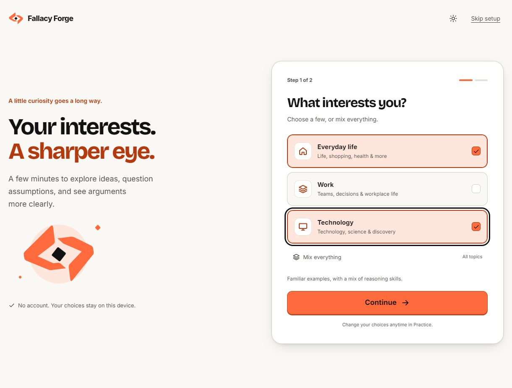

Fallacy Forge offers three ways to practice clear thinking. **Spot the flaw** uses short, realistic passages mixed with **sound near-misses**: arguments that only look broken. **Fix the argument** asks you to choose a stronger revision. **What follows?** gives you facts and a claim: must it be true, must it be false, or could it be either?

## Screenshots

| Choose an activity | Fix the argument | What follows? |
| --- | --- | --- |
| 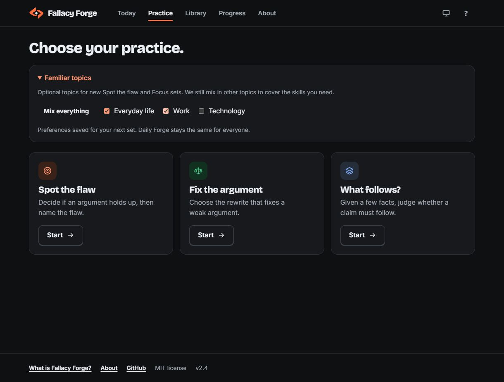 | 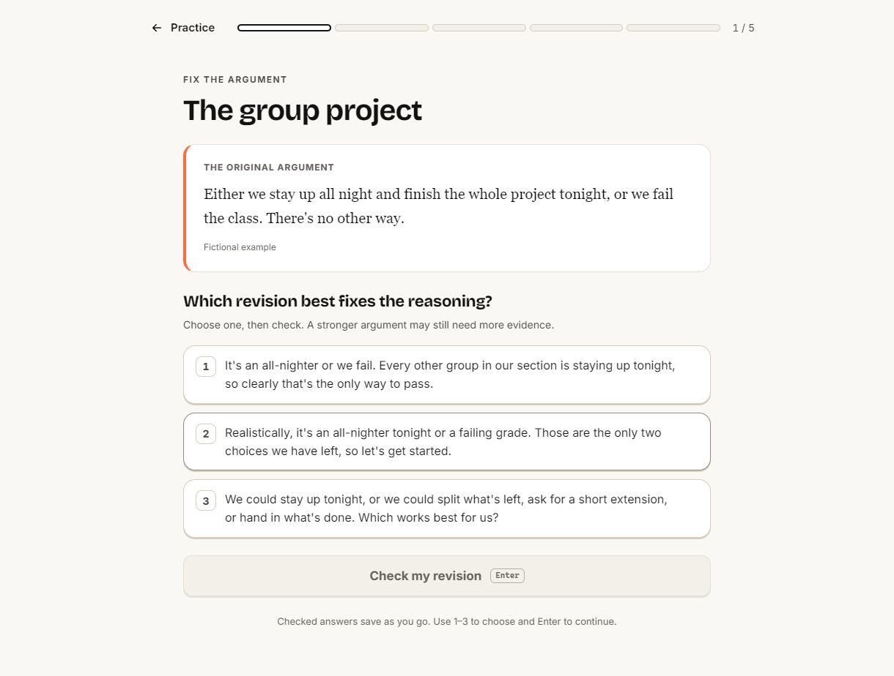 | 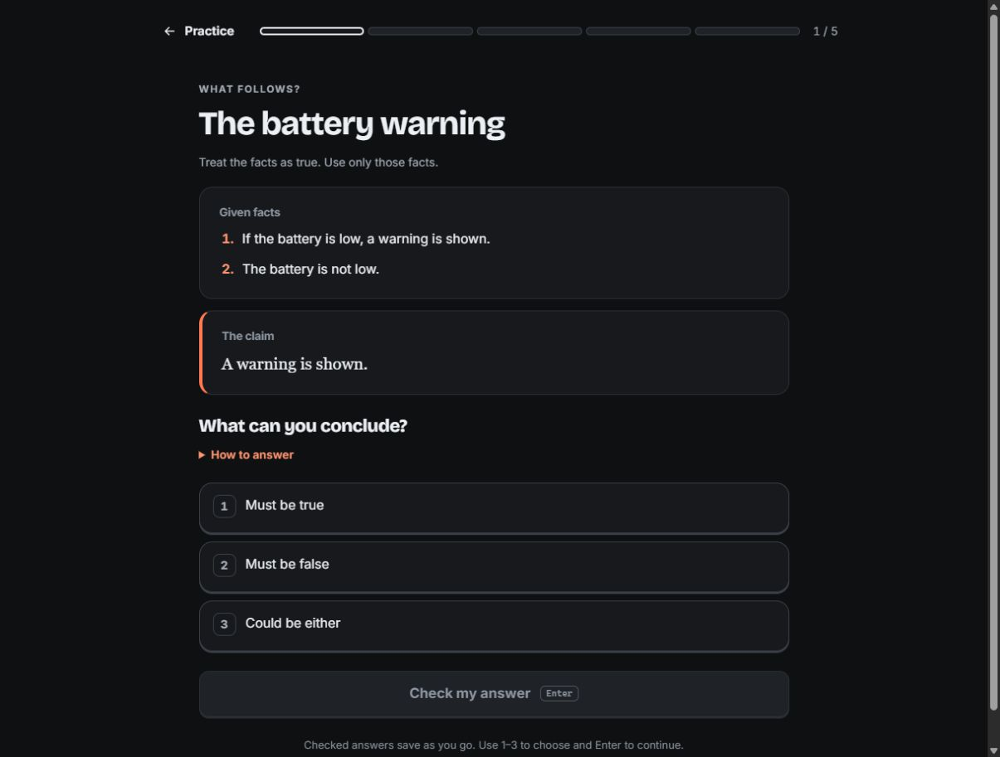 |

| Today | Spot the flaw | Learn from the answer |
| --- | --- | --- |
| 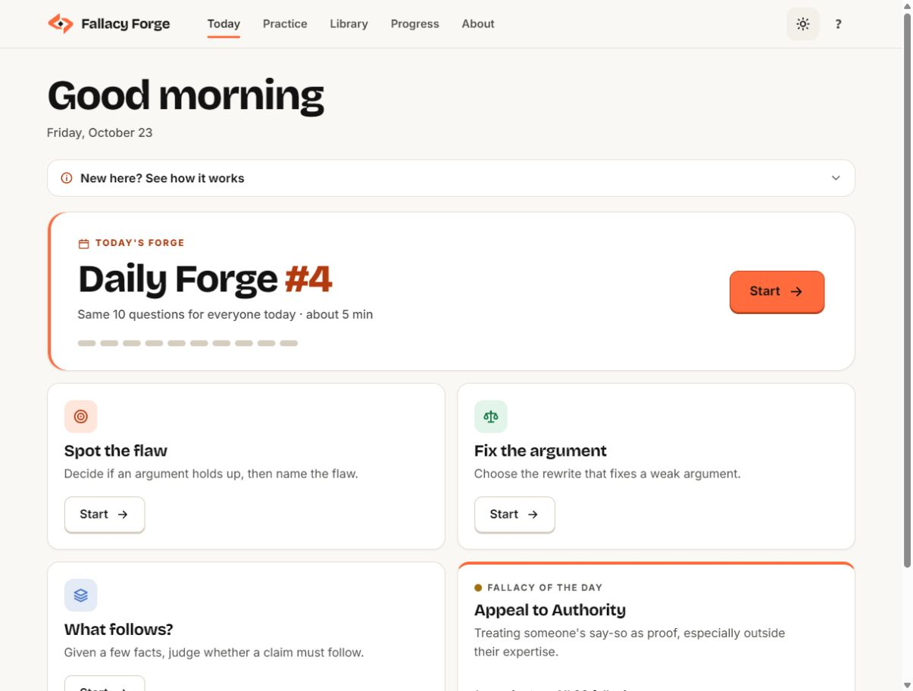 | 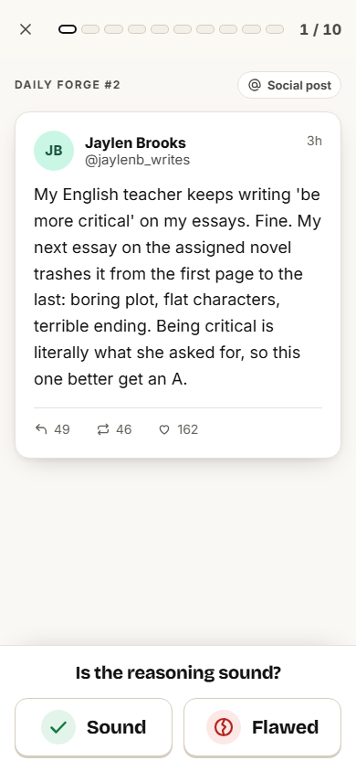 | 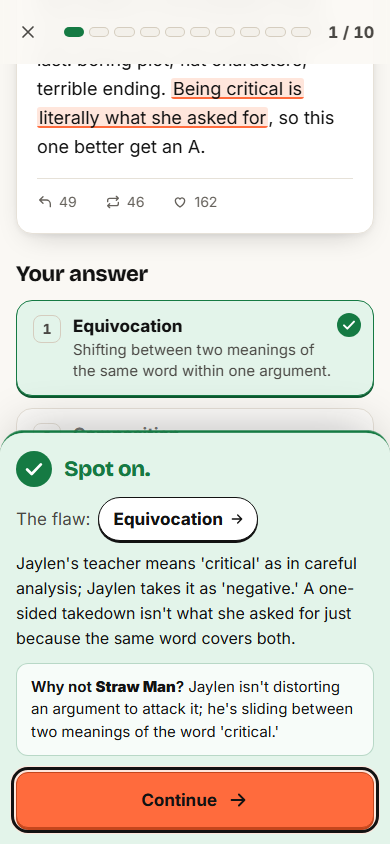 |

| Library | Fallacy detail | Progress |
| --- | --- | --- |
| 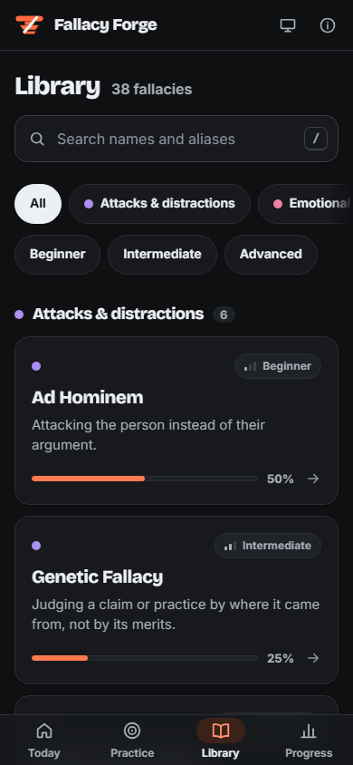 | 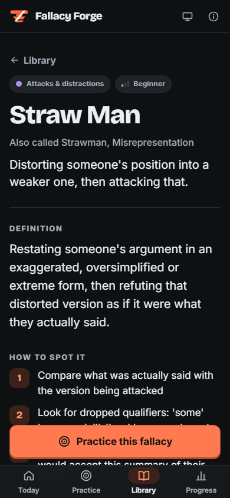 | 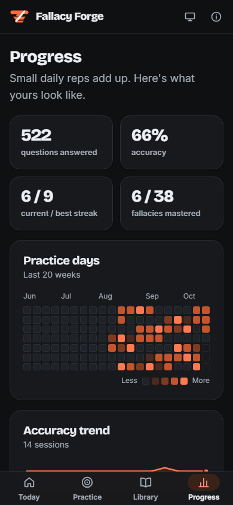 |

## How it works

On your first home visit, a short welcome asks about **interests** and an optional **starting comfort**. Back keeps your draft choices, and Skip setup leaves them unsaved. Finishing starts five questions, with the starting mix informed by your answer; this is a preference, not a level assessment. No answer means a gentle mix. Normal adaptive Practice follows, and Daily Forge keeps its shared questions. Choices stay in the browser and can be changed from Practice or Progress → Change your setup ([open setup directly](https://itsothmane03-byte.github.io/Logic-Forge/#/setup)).

Existing learning history bypasses the welcome. Reopening setup prefills your choices; Cancel changes nothing. If any activity is already open, Save and return preserves its draft instead of replacing it. Progress export/import includes the optional starting preference, older saves remain compatible, and reset keeps your settings.

In **Spot the flaw**, each question is two small steps, then the lesson:

1. **Spot.** Is the reasoning sound or flawed?
2. **Name.** If it's flawed, which fallacy? Four options, and the wrong ones are deliberately its closest look-alikes.
3. **Learn.** The flawed phrase lights up in the passage, with an explanation of the answer. A "Why not X?" comparison appears only when you actually picked X and a written comparison exists for it.

Scoring is honest about near-misses: **correct** (right call, right name), **right instinct** (you saw the flaw but picked the wrong name) or **missed**.

In **Fix the argument**, read a fictional argument, choose one of three revisions, and check why that revision helps or leaves a problem unresolved. Five exercises make a set. Options are shuffled, exercises do not repeat within a set, and unseen exercises come before recently answered ones. A stronger revision can still need more evidence; the exercise does not establish a real-world claim as true.

In **What follows?**, treat a few facts as given and classify a claim. Every allowed combination of facts is checked to compute the answer. Optional examples show situations that fit, including a true and a false case when both are possible. “Could be either” makes no probability claim. Five unique puzzles make a set; unseen puzzles come first, then the least recently answered.

Both activities offer a missed-only retry after a set. Retries count as new attempts in that activity’s scores. Checked answers save immediately; unfinished sets resume during navigation, while refreshing starts a new set.

In all three activities, **Previous** revisits answered questions and their feedback. **Next** moves forward through that review; **Return to current** goes straight back to your unfinished question, preserving any selection. Earlier answers stay read only and do not change your score. Reopened Daily sets retain results but may no longer have the original choices to display.

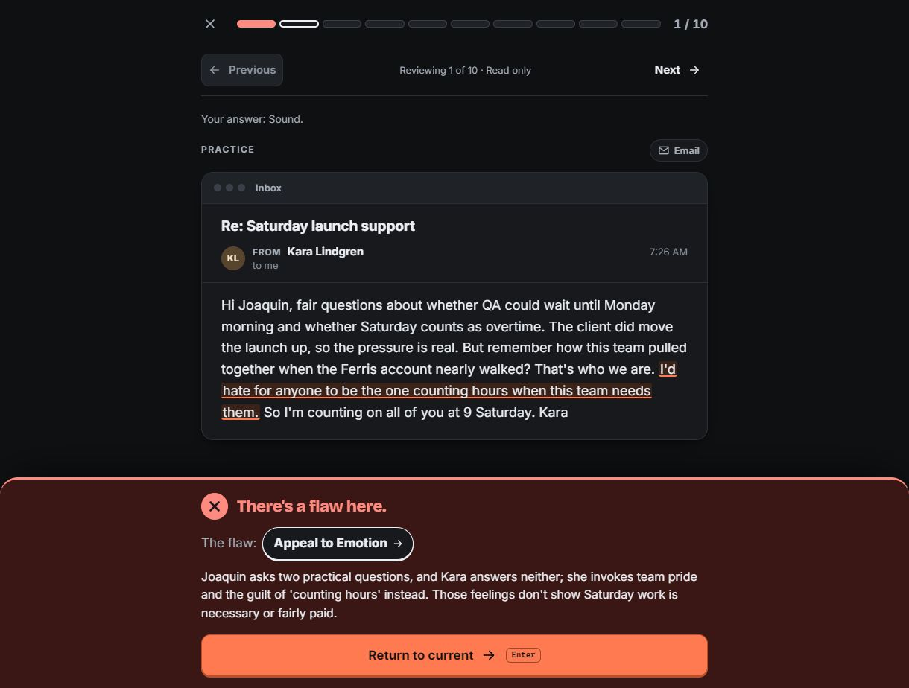

## Features

- **Practice hub.** Three short activity cards: spot a flaw, repair an argument, or practice deduction. All are available from Today; the original practice URL still works.
- **Question review.** Look back through answered questions during a set, with original feedback and a quick return to your current answer.
- **Argument repair.** 15 exercises across 15 fallacies in all six families. Short sets of five, feedback for each selected revision, library links, and separate local scores/history. Repairs do not change quiz mastery, quiz accuracy, or Daily streaks.
- **Deduction.** 18 exercises with computed answers, optional help and examples, separate scores, and missed-only retries. Deduction does not change quiz mastery or Daily streaks.
- **Daily Forge.** The same ten questions for everyone each day (seeded by date: 8 flawed from 8 different fallacies across three difficulty levels, plus 2 sound), resumable, with a Wordle-style share grid.
- **Adaptive practice.** One Leitner box (1 to 5) per fallacy. Mistakes come back sooner, recently seen items are held back, and the same fallacy never appears twice in a row.
- **Familiar topics.** Optional Everyday life, Work and Technology preferences under Practice → Familiar topics, or Mix everything. New Spot the flaw and Focus sets choose the reasoning skill and difficulty first, then prefer a familiar example where one is available. Preferences save in your browser and travel with progress exports; Daily Forge keeps its shared question set.
- **Another example, no penalty.** In an unanswered Practice or Focus question, open Unfamiliar topic? → Show another. The replacement has the same reasoning difficulty and does not count as a wrong answer or change your score. It practices the same skill where possible, otherwise another skill. Replaced examples cannot reappear within that set. This is available before choosing Sound or Flawed; checked answers remain locked.
- **Focus mode.** Ten questions on one fallacy, mixed with its look-alikes so it can't be pattern-matched.
- **Review mistakes.** Your recent misses, newest first.
- **The library.** All 38 fallacies: definition, how to spot it, a classic example, **when the move is actually legitimate**, contrasts with its look-alikes, and two passages "in the wild" with a reveal toggle.
- **Progress.** Mastery by family, current and best streak, a 20-week practice heatmap, an accuracy trend, separate activity counters, and export, import or reset of your data. Completed quiz history saves with the final answer. Reset/import or a learning change in another tab clears stale active sessions; settings-only changes preserve them.
- **Private by design.** No accounts, analytics, or progress uploads. Progress lives in your browser's local storage.
- **Works everywhere.** Installable PWA that works offline after the first visit, phones from 320px to wide desktops, light and dark themes, keyboard shortcuts (`S` / `F`, `1`–`4`, `Enter`, `/`, `?`), with WCAG 2.2 AA as the accessibility target.

## Content quality

Content is the product, so it goes through two gates before it ships:

- **38 fallacies in 6 families, 304 questions.** Each fallacy has 6 flawed passages (two at each difficulty level) and 2 sound near-misses. People, companies, towns and outlets are fictional, and partisan hot-button topics are off-limits.
- **Automated validator** (`npm run content`). Enforces the schema and every length limit, exact verbatim cues, the canonical "confusable with" lists, required titles, unique ids and the 6 + 2 composition per fallacy, then prints distribution stats (formats, tags, difficulty, passage-length percentiles).
- **Independent AI blind review of the quiz bank.** All 304 quiz questions were labelled blind by an independent AI reviewer: 302/304 (99.3%) agreement in round 1; all 21 revised questions confirmed in round 2. See [content/review/README.md](content/review/README.md). Those results apply to the identification quiz, not the new repair collection, and are not human expert validation.
- **Repair collection.** Authored separately in `src/data/repairs.ts`, with a single best revision, explanations for all three choices, and content/selection tests. See the [separate AI content check](content/review/repairs-2026-10-22.md) for scope and corrections. History and scores use the same local export/import/reset controls; older progress exports remain compatible.
- **Deduction collection.** Authored in `src/data/logic.ts`; a small exhaustive evaluator checks each permitted assignment. Tests cover answer classification, example validity, consistent facts, unique IDs, and selection. A separate AI read-through found no text/expression mismatch; this is not human expert validation. See [the review scope](content/review/logic-2026-10-22.md).
- **Background knowledge.** Each quiz item labels the outside knowledge it needs separately from its reasoning difficulty: general, explained, or specialist. The current collection has 290 general and 14 explained examples, with 40 passages revised for plain language and supplied facts. Adaptive sets exclude specialist items. See [the topic and language review](content/review/topics-2026-10-22.md); this is an AI review, not a human comprehension study.

The full writing standard is in [`docs/CONTENT-SPEC.md`](docs/CONTENT-SPEC.md).

## Tech stack

| Area | Choice |
| --- | --- |
| Build | Vite 8 (Rolldown) + TypeScript 7, strict |
| UI | Preact 11 + `@preact/signals`, a tiny hand-written hash router |
| Styles | Plain CSS with design tokens; self-hosted Inter and Bricolage Grotesque |
| Offline | `vite-plugin-pwa` (Workbox precache, auto-update) |
| Tests | Vitest + jsdom + Testing Library |
| CI / hosting | GitHub Actions, GitHub Pages |

The app's JavaScript has a **150 KB gzip budget**, checked during each build; the identification question bank loads as its own chunk. Selection, deduction evaluation, scoring, mastery, streaks, storage and sharing use pure TypeScript with unit tests.

```
content/      fallacies/ and items/ (authored JSON), fixtures/ (dev only), source/ (v0 reference)
scripts/      canonical.mjs, validate-content.mjs, build-bank.mjs, check-bundle.mjs, dev/ (browser checks)
src/
  data/       bank.json (generated and committed), repairs.ts, logic.ts (authored)
  engine/     pure logic: rng, daily, select, repair, logic, distractors, score, mastery, streak, storage, share, stats
  state/      signals: progress, settings, current session
  ui/         components/, screens/, styles/
tests/        engine/*.test.ts, content.test.ts, activity flows, lifecycle/feedback regressions
```

## Development

Requires Node 22 (22.22+) or 24.

```bash
npm ci
npm run dev          # local dev server
npm run content      # validate content (strict) and rebuild src/data/bank.json
npm run typecheck    # tsc --noEmit, strict
npm test             # Vitest
npm run build        # production build + bundle budget check
npm run preview      # serve the production build
```

The content pipeline has two flags for authors: `--allow-partial` skips the completeness checks while content is being written (`npm run content:check`), and `--fixtures` builds a small dev bank from `content/fixtures/` (`npm run content:fixtures`; it overwrites `src/data/bank.json`, so run `npm run content` afterwards to restore the real bank).

Pushing to `main` deploys to GitHub Pages through [`.github/workflows/pages.yml`](.github/workflows/pages.yml); every push and pull request runs typecheck, content validation, tests and the build in [CI](.github/workflows/ci.yml).

## Contributing

New passages, fixes and accessibility improvements are welcome. See [CONTRIBUTING.md](CONTRIBUTING.md).

## License

[MIT](LICENSE) © 2025 itsothmane03-byte. Built by Othmane.
