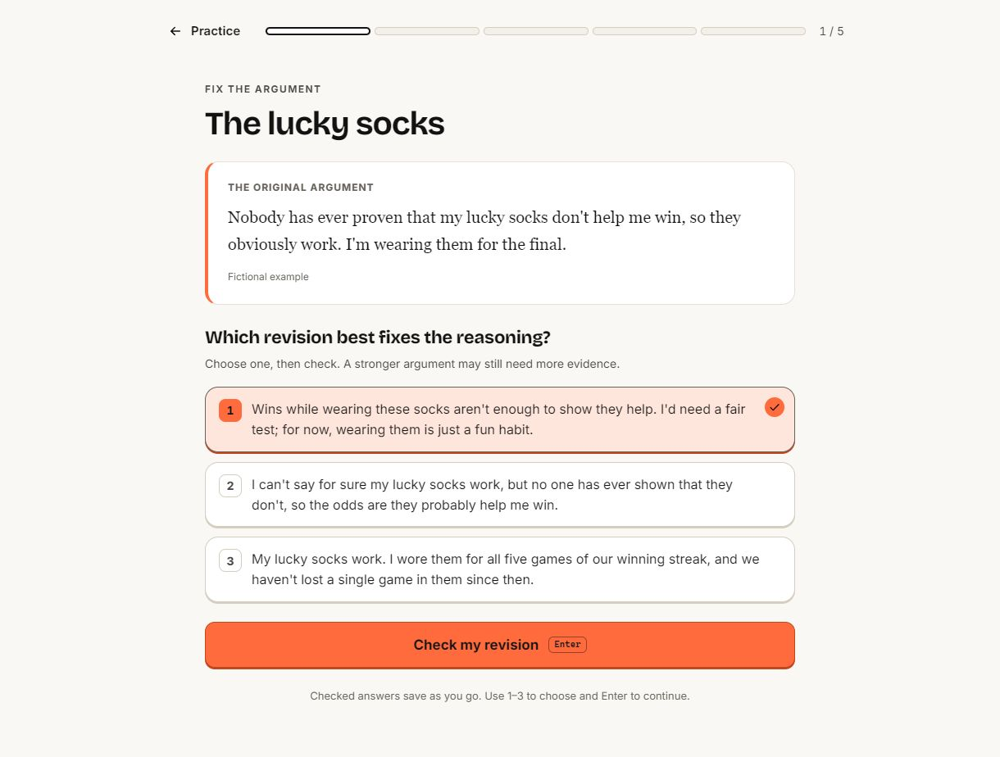

# Fallacy Forge

**Short activities for clearer thinking.**

[Try the live app](https://itsothmane03-byte.github.io/Logic-Forge/) · [MIT license](LICENSE)

[](https://github.com/itsothmane03-byte/Logic-Forge/actions/workflows/ci.yml)


## Practice

- **Spot the flaw:** decide whether an argument is sound, then identify its fallacy. Includes 304 fictional questions across 38 fallacies, with explanations for your answers.
- **Fix the argument:** choose a stronger revision in five-exercise sets.
- **What follows?:** use the given facts to decide whether a claim must be true, must be false, or could be either.

| Spot the flaw | Fix the argument | What follows? |
| --- | --- | --- |
|  |  |  |

**Daily Forge** gives everyone the same ten questions for that date. Ordinary quiz practice adapts to previous answers. Optional topic preferences favor familiar examples in new Spot the flaw and Focus sets; all topics can still appear. A five-question warm-up is available from Practice preferences.

Earlier answers can be revisited during a set without changing the score. Practice includes focused sets, mistake review, and a searchable fallacy library.

## Saved progress

Answers and settings stay in your browser. Export a backup or move progress to another device from the Progress page; there is no automatic account sync. The app works offline after its files have been cached. Light and dark themes, keyboard controls, and layouts from 320px upward are supported.

## Run locally

Use Node 22.22+ or a newer supported version, then:

```sh
npm ci
npm run dev
```

Before submitting a change, run the same checks as CI:

```sh
npm run content
npm run typecheck
npm test
npm run build
```

`npm run content` validates the authored JSON and rebuilds the committed question bank. `npm run preview` serves the production build. Pushing to `main` deploys through GitHub Pages.

## Project notes

A static Preact, TypeScript and Vite app with browser-local storage. No backend is required. The build checks a 150 KB gzip budget for app JavaScript, with the quiz bank in its own chunk.

- [Architecture and UI conventions](docs/ARCHITECTURE.md)
- [Contributing and content workflow](CONTRIBUTING.md)
- [Content specification](docs/CONTENT-SPEC.md)
- [Content review records](content/review/README.md)
- [Brand source and icon generation](docs/brand/README.md)
- [Changelog](CHANGELOG.md)

All exercise scenarios are fictional. The repository keeps the content sources, validation rules, and documented AI review records alongside the application.

Built by Othmane. [MIT](LICENSE) © 2025 itsothmane03-byte.
